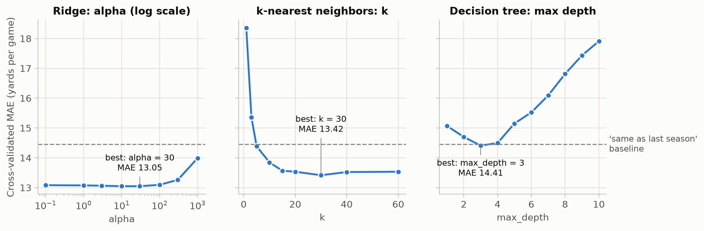
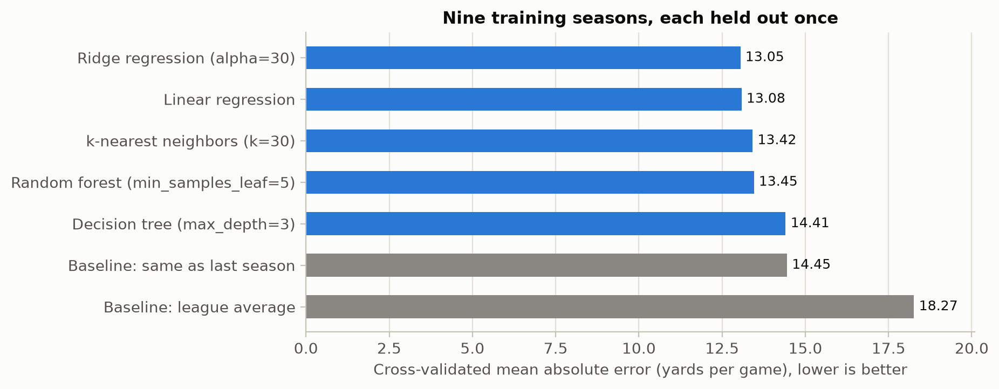
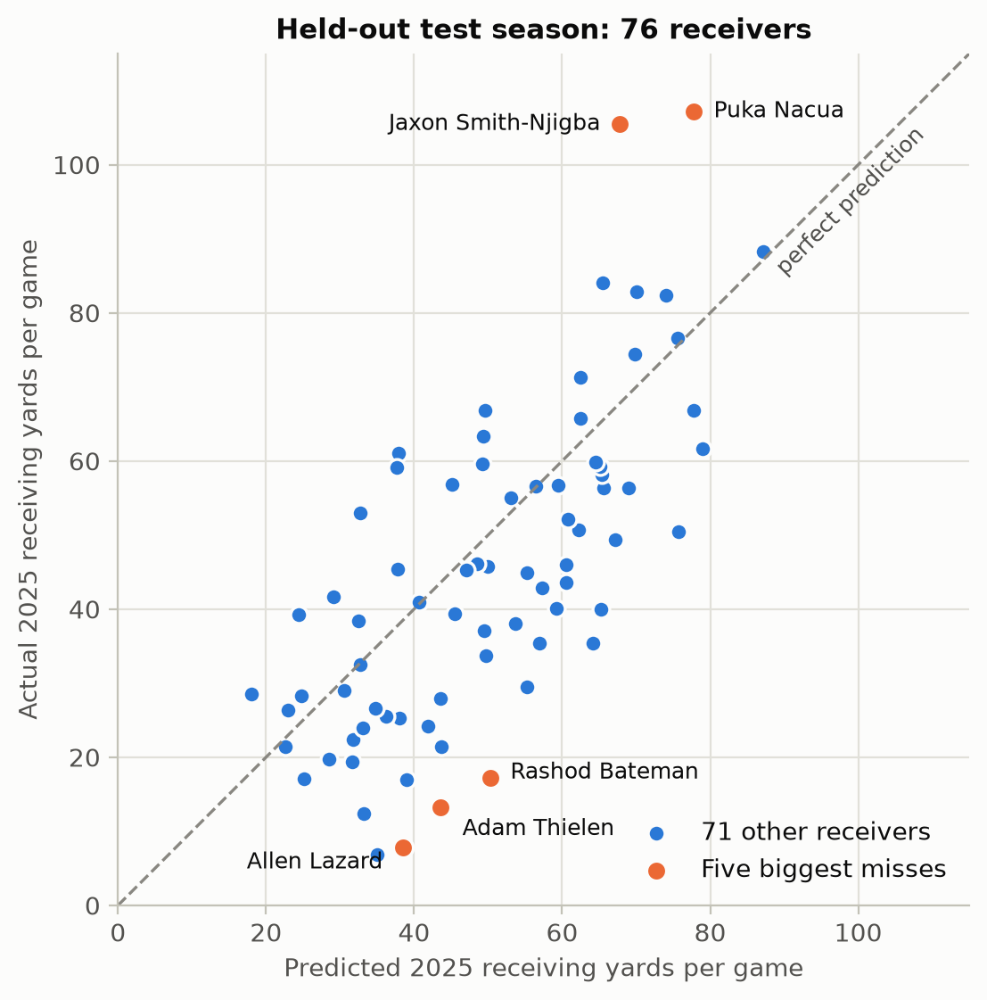
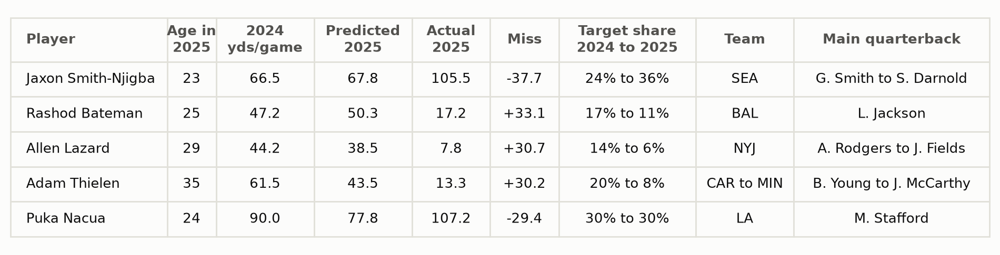
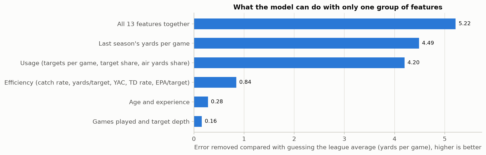

# Can Last Season Predict a Wide Receiver's Next One? A Regression Model, and Five Players It Got Wrong

*INST414 Module 5. Code and data: [github.com/johnpluto2k/nfl-wr-yards-forecast](https://github.com/johnpluto2k/nfl-wr-yards-forecast)*

## The question

Every March, NFL teams pay wide receivers for what they did last season. What the team actually buys is next season.

**Question:** Using only what a wide receiver did this season, how well can we predict his receiving yards per game next season, and which of this season's numbers actually carry over?

**Stakeholder and decision:** An NFL pro-personnel (pro scouting) staff, the same group I wrote for in my [Module 3 post](https://medium.com/@jbae12/four-kinds-of-nfl-wide-receiver-clustering-the-2025-season-by-how-players-are-used-c0ee7ee26018). Before free agency and the trade deadline they have to decide which veteran receivers to pursue and how much production to expect from each one. The answer informs (1) how big an offer a receiver's last season justifies and (2) which stats on his page to trust when two candidates look similar.

## The data

**The ideal data** for this question would follow every receiver across seasons and include things that change between them: routes run and where he lined up, the quarterback and teammates he will have next year, his injury history, his contract, and player-tracking data on how open he gets. Most of that is not public, and next year's teammates are not known when the decision is made.

**What I used** is a subset of that: public game-by-game player stats for the 2015 to 2025 NFL regular seasons, plus a player table with birth dates.

- **Weekly player stats** (191,281 player-game rows): for each player in each game, his team, targets, receptions, receiving yards, touchdowns, air yards (how far downfield his targets were thrown), yards after the catch and receiving EPA (expected points added).
- **Players table:** birth date and rookie season, for age and experience.

I turned these into one row per receiver per pair of seasons. The row holds his stats from season N and one extra number from season N+1.

**Ground-truth labels.** The label is the receiver's **receiving yards per game in season N+1**. Nobody hand-labeled anything. The labels are what actually happened on the field the following year, as recorded in the NFL's official play-by-play and compiled by nflverse. For a 2024 row, the label is the player's 2025 yards divided by his 2025 games.

**Why it is relevant:** these are the same numbers a scouting staff has in front of it in March, and the label is the thing they are trying to buy.

**Filters:** a row needs at least 50 targets in season N (about three a game) and at least 8 games played in season N+1. That left 855 receiver seasons with 50+ targets, of which 149 were dropped for playing fewer than 8 games the next year, so **706 rows** were used.

## How the data was collected

The data comes from [nflverse](https://github.com/nflverse), an open-source project that publishes NFL stats. I downloaded 11 weekly stat files, two season files and the players file as CSVs from the [nflverse-data GitHub releases](https://github.com/nflverse/nflverse-data/releases) on November 20, 2026 with Python's `requests` library, and saved a sha256 hash of each file. Everything after that used `pandas`, `scikit-learn` and `matplotlib`.

## Regression or classification?

This is a **regression** problem. The target, next season's receiving yards per game, is a continuous number. In my data it runs from under 1 to 114.5, with an average of 50.

I could have turned it into classification, for example "will he reach 1,000 yards, yes or no?". I decided against it for two reasons. A yes/no label treats 990 yards and 1,010 yards as opposites and treats 1,010 and 1,700 as the same. And the staff needs a size, because a contract offer depends on how much production to expect.

I used yards per game, not season totals, so that a missed game or the move from 16 to 17 games in 2021 does not change the label.

## Features

Each row has 13 features, all from season N:

- **Production:** receiving yards per game.
- **Usage:** targets per game, target share (his share of the team's targets) and air yards share. Both shares only count the games he played.
- **Efficiency:** catch rate, yards per target, yards after catch per reception, touchdowns per target and EPA per target.
- **Other:** games played, average depth of target, age on September 1 of the season being predicted, and NFL seasons of experience.

I left out anything from season N+1 on purpose. His next team and next quarterback are in my file, but only so I can look at the errors afterwards.

## Choosing and training the model

**Train and test split.** I split by time. The model trains on the nine season pairs from 2015 through 2023 (630 rows) and is tested once on the newest pair, 2024 predicting 2025 (76 rows). A random split would put the same season, and often the same player, on both sides.

**Cross-validation.** To compare models I held out one whole training season at a time (nine folds) and measured mean absolute error (MAE), the average miss in yards per game.

**Two baselines.** Guessing the league average for everyone misses by 18.27 yards per game. Guessing "same as last season" misses by 14.45.

I tried linear regression, ridge regression (linear regression that shrinks its coefficients, which helps when features overlap), k-nearest neighbors, a decision tree and a random forest.

*Figure 1. Cross-validated error for three models as one hyperparameter changes. The dashed line is the "same as last season" baseline.*

The hyperparameters behaved the way the course labs suggest. The decision tree was best at a depth of 3 (14.41) and got worse with every level after that, up to 17.91 at depth 10, which is overfitting. k-nearest neighbors with k = 1 (18.35) was worse than guessing the average and leveled off around k = 30 (13.42). Ridge barely cared about alpha.

*Figure 2. Best setting of each model against the two baselines.*

**Ridge regression with alpha = 30** had the lowest error (13.05), just ahead of plain linear regression (13.08). I chose it because the relationship is close to linear, the dataset is small (630 rows) and several features measure nearly the same thing. The more flexible models had nothing extra to find.

## How well does it work?

I refit the ridge model on all nine training seasons and scored it once on the 2025 season, which it had never seen.

- **MAE 12.95 yards per game**, against 14.20 for "same as last season" and 18.34 for the league average. That is about 9% better than assuming he repeats, and about 220 yards over a 17-game season.
- **R² of 0.48**, so the model explains about half of the differences between receivers. "Same as last season" gets 0.32.
- 32 of 76 predictions (42%) were within 10 yards per game. 17 of 76 missed by more than 20.
- In cross-validation the model beat "same as last season" in all nine held-out seasons, so the test result was not a lucky year.

So the model is useful but not precise. It also has a bias: on the 2025 test season it predicted 4.9 yards per game too high on average, because this group of receivers dropped more than usual (from 51.1 to 44.8).

One more check for honesty: on the test season the depth-3 decision tree had a slightly lower MAE (12.66) but a worse R² (0.40). I kept the model that cross-validation picked.

*Figure 3. Each dot is one receiver in the test season. Dots on the dashed line were predicted exactly.*

## Five receivers the model got wrong

These are the five largest misses in the test season.

*Table 1. "Miss" is predicted minus actual. "Team" is the team he played the most games for. Target share, team and quarterback for 2025 were not available to the model.*

**1. Jaxon Smith-Njigba (predicted 67.8, actual 105.5).** The model expected a repeat of 2024. Instead his target share jumped from 24% to 36%. Seattle's second and third most-targeted receivers from 2024, DK Metcalf (108 targets) and Tyler Lockett (74), both played for other teams in 2025, and the quarterback changed from Geno Smith to Sam Darnold. The model has no feature for teammates leaving. His 105.5 is also the 8th-highest label of all 706 rows, and a model trained on averages almost never predicts a season that rare.

**2. Rashod Bateman (predicted 50.3, actual 17.2).** His 2024 was built on efficiency. He scored 9 touchdowns on only 72 targets and gained 10.5 yards per target, after 6.6 the year before. The model gives efficiency only a little credit, but that was still too much. In 2025 his yards per target fell back to 5.9, his target share fell from 17% to 11%, and Baltimore added DeAndre Hopkins.

**3. Allen Lazard (predicted 38.5, actual 7.8).** His quarterback changed from Aaron Rodgers to Justin Fields and he got 18 targets in 9 games. His history shows a pattern the model could not see: 788 yards with Rodgers in Green Bay in 2022, 311 with Zach Wilson as the Jets' main quarterback in 2023, then 530 in 12 games with Rodgers in 2024.

**4. Adam Thielen (predicted 43.5, actual 13.3).** At 35 he was the oldest receiver in the test set, and only 11 of my 630 training rows are 34 or older. The model did predict a drop from his 61.5, but a straight-line age effect is too gentle for the end of a career. He also left Carolina and split 2025 between Minnesota (9 games) and Pittsburgh (5), and his target share fell from 20% to 8%.

**5. Puka Nacua (predicted 77.8, actual 107.2).** Nothing changed around him: same team, same quarterback, same 30% target share. The model pulled him down from 90.0 because that is what usually happens. The 55 training receivers at 85 or more yards per game averaged 94.3 and then 77.3 the next year. Nacua went up instead.

**What the misses have in common.** Three were over-predictions for players whose role collapsed, and two were under-predictions for young stars. In four of the five, the receiver's role changed after the season ended: target share fell by a third or more for Bateman, Lazard and Thielen, and rose by half for Smith-Njigba. The fifth is the cost of a model that leans toward the middle. Its highest prediction was 87.2 while six receivers actually reached 80 or more, and it under-predicted those six by 18 yards per game on average.

## The answer: what carries over

*Figure 4. I refit the model using one group of features at a time. Bars show how much error each group removes compared with guessing the league average.*

**Yes, partly.** One season of stats predicts about half of what a receiver does next, with a typical miss of 13 yards per game. For the scouting staff, the more useful answer is which numbers do the predicting:

1. **Volume carries over. Efficiency mostly does not.** Using only the three usage features removes 4.20 of the 18.27 yards per game of baseline error, almost as much as last season's yards per game (4.49). The five efficiency stats together remove 0.84. In the full model, one standard deviation of yards per game is worth +5.1 and targets per game +4.8, while no efficiency stat is worth more than 1.7. A big season built on touchdowns and yards per target, like Bateman's, is the one to be careful about.
2. **Expect a step back.** In the training data, receivers averaged 54.3 yards per game in the season that got them into the dataset and 50.3 the next. That is why "same as last season" loses to the model every year.
3. **Age adds the most on top.** Removing age and experience from the full model costs more accuracy than removing any other group (MAE 13.05 to 13.36). Each standard deviation of age (about three years) is worth −3.5 yards per game.
4. **Adjust by hand for what changed.** The largest errors came from role changes the data cannot see. In cross-validation the model missed by 14.8 for receivers who changed teams and 12.5 for those who stayed. The staff knows who is leaving and arriving, so the model should be a starting point.

## Cleaning, bugs, and how I checked the AI's work

**Cleaning.** I kept regular-season games only, summed the weekly rows into seasons, and assigned a traded player to the team he played the most games for. EPA is blank in weeks with no targets, so I filled those with 0 before summing.

**Bugs others might hit:**

- nflverse's season target share divides by the team's targets for the whole season, including games the player missed. I recomputed it over games played. For receivers who played all 17 games for one team, my number matches nflverse's exactly (31 players in 2024, 22 in 2025).
- A traded player can play 18 games because of bye weeks. Rashid Shaheed did in 2025, and it broke one of my own checks that assumed 17 was the maximum.
- A random train/test split leaks information here. Splitting by season avoids it.

**AI assistance.** I used an AI assistant (Claude, through Claude Code) to write the download, dataset and modeling code and a first draft of this post. AI output can be confidently wrong, so I had it write checks that actually run (`src/validate.py`). All 24 pass, and I read the results and the five player cases myself.

**Input checks:** my 2024 and 2025 season totals (games, targets, catches, yards, touchdowns) match nflverse's own season files for every receiver with 50+ targets, 167 players and 0 mismatches. Two totals I had checked against ESPN for my Module 3 post (Smith-Njigba's 1,793 yards and Nacua's 129 catches) still match. There are no missing values or duplicate rows, and every label equals the next season's yards per game recomputed from the season table.

**Output checks:** refitting the model from scratch reproduces the saved predictions. With the labels shuffled, cross-validated R² drops from 0.49 to about −0.02, so the model is not finding patterns in noise. Predictions range from 18.0 to 87.2, which is plausible for NFL receivers.

## Limitations and bias

- **Survivorship bias.** 149 of 855 receiver seasons (17%) were dropped because the player played fewer than 8 games the next year, usually because of injury or losing his job. The model predicts yards per game for a receiver who stays healthy and employed, so it is optimistic for the whole group.
- **What's missing.** Nothing about the offseason: new quarterback, teammates arriving or leaving, coaching changes, injuries. No routes run, alignment or tracking data. Only one prior season per player, and rookies cannot be predicted at all.
- **Pull toward the middle.** The model under-predicts the best receivers, which matters because those are the most expensive decisions.
- **One test season.** 76 players is a small test set. The team-change pattern from cross-validation did not show up in it (11.6 for the 19 who moved, 13.4 for those who stayed).
- **Yards are not only the receiver.** They depend on the quarterback and play caller, and the game itself changed over these 11 seasons.

## Conclusion

A simple ridge regression on one season of stats beats "he'll do what he did last year" by about 9% and explains about half of next season's yards per game. A receiver's workload and age predict his next season, and his efficiency mostly does not. The biggest misses were role changes that happened after the season, which a scouting staff can see coming and the model cannot.

All code, data and results: [github.com/johnpluto2k/nfl-wr-yards-forecast](https://github.com/johnpluto2k/nfl-wr-yards-forecast). The README explains how to re-run everything.

**Sources and tools:** nflverse weekly player stats 2015 to 2025 and players table (https://github.com/nflverse/nflverse-data); Python 3.14 with requests, pandas, scikit-learn and matplotlib.
